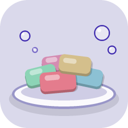

# Soap Dish

[English](#english) | [日本語](#日本語)



---

## English

Nine pastel light themes for VS Code, cut from one bar: **Purple, Red, Pink, Yellow, Green, Blue, Blue Gray, Coffee Cream, and Cream**.
Soft tinted surfaces, a deeper accent in the same hue, and warm amber keywords. All nine share the same skeleton, so switching between them changes the mood without moving anything.

### Variants

| Theme | Hue | Editor background | Accent |
|---|---|---|---|
| Soap Dish: Purple | 249° | `#dad9eb` | `#422eb0` |
| Soap Dish: Red | 350° | `#efd5dc` | `#cd112f` |
| Soap Dish: Pink | 328° | `#ebd9e4` | `#b02e73` |
| Soap Dish: Yellow | 42° | `#ebe4d9` | `#b08a2e` |
| Soap Dish: Green | 155° | `#dbe9e2` | `#3ea078` |
| Soap Dish: Blue | 195° | `#d9e8eb` | `#2e8fb0` |
| Soap Dish: Blue Gray | 218° | `#d9e1eb` | `#2e5db0` |
| Soap Dish: Coffee Cream | 25° | `#e8e0dc` | `#996845` |
| Soap Dish: Cream | 40° | `#edebe8` | `#867758` |

Red is a little more vivid so it reads clearly next to Pink. Green and Coffee Cream are toned down. Cream is whipped cream rather than custard: a warm off-white gray that stays easy on the eyes.

### Install

From VS Code, open the Extensions view (`Cmd+Shift+X` / `Ctrl+Shift+X`), search for **Soap Dish**, and install. Or run this from the Command Palette:

```
ext install tinklingway.soap-dish
```

Then pick a theme with **Preferences: Color Theme** (`Cmd+K Cmd+T` / `Ctrl+K Ctrl+T`) and choose any **Soap Dish: …** entry.

To install from a `.vsix` file instead, use **Extensions: Install from VSIX…** in the Command Palette, or `code --install-extension soap-dish-0.0.1.vsix`.

### How the colors work

Every variant has a pale tinted background, a deeper color of the same hue for selections and other "current" states, and near-black text of the same hue. Those are the colors that change between variants. Everything that carries meaning stays the same in all nine: amber keywords and cursor, blue functions, green strings, purple types, crimson variables, red constants and errors, orange numbers, magenta parameters, teal declarations, and gray italic comments. So an error is red whichever soap you pick.

If you want to change a color or add a variant, see [DEVELOPMENT.md](DEVELOPMENT.md).

### Credits and license

Soap Dish is released under the **GNU General Public License v3.0**. See [LICENSE](LICENSE).

It is a derivative work of [Bearded Theme](https://github.com/BeardedBear/bearded-theme) by BeardedBear ([Marketplace](https://marketplace.visualstudio.com/items?itemName=BeardedBear.beardedtheme)), which is licensed under GPL-3.0. The Purple source theme started from the output of VS Code's *Generate Color Theme From Current Settings* while Bearded Theme Milkshake Blueberry was active, so its workbench palette, syntax palette and TextMate scope mapping come from that theme. The other eight variants are generated from Purple by hue rotation. Credit for the underlying design belongs to BeardedBear; the hue-rotation generator, the variant set, the icon and the documentation are additions made here.

Copyright (C) 2026 TinklingWay. Bearded Theme is Copyright (C) BeardedBear.

---

## 日本語

VS Code のライトカラーテーマ 9 色セット。**Purple・Red・Pink・Yellow・Green・Blue・Blue Gray・Coffee Cream・Cream**。
薄く色づいた地に同系の濃いアクセント、琥珀のキーワード。9 色とも骨格が同じなので、切り替えても配置はそのままで雰囲気だけ変わる。

### バリエーション

| テーマ名 | 色相 | 地(エディタ) | アクセント |
|---|---|---|---|
| Soap Dish: Purple | 249° | `#dad9eb` | `#422eb0` |
| Soap Dish: Red | 350° | `#efd5dc` | `#cd112f` |
| Soap Dish: Pink | 328° | `#ebd9e4` | `#b02e73` |
| Soap Dish: Yellow | 42° | `#ebe4d9` | `#b08a2e` |
| Soap Dish: Green | 155° | `#dbe9e2` | `#3ea078` |
| Soap Dish: Blue | 195° | `#d9e8eb` | `#2e8fb0` |
| Soap Dish: Blue Gray | 218° | `#d9e1eb` | `#2e5db0` |
| Soap Dish: Coffee Cream | 25° | `#e8e0dc` | `#996845` |
| Soap Dish: Cream | 40° | `#edebe8` | `#867758` |

Red は隣の Pink とはっきり区別がつくよう少し鮮やかに、Green と Coffee Cream は色を落として柔らかくしている。Cream はカスタードではなく生クリーム。目に優しい暖かみのある灰白。

### インストール

VS Code の拡張機能ビュー(`Cmd+Shift+X` / `Ctrl+Shift+X`)で **Soap Dish** を検索してインストールする。コマンドパレットから次を実行してもよい。

```
ext install tinklingway.soap-dish
```

そのあと **基本設定: 配色テーマ**(`Cmd+K Cmd+T` / `Ctrl+K Ctrl+T`)で **Soap Dish: 〜** のどれかを選ぶ。

`.vsix` ファイルから入れる場合は、コマンドパレットの **拡張機能: VSIX からのインストール…** か、`code --install-extension soap-dish-0.0.1.vsix` を使う。

### 配色の考え方

どの色も、薄く色づいた地、選択範囲などの「いま見ている」印に使う同系の濃い色、同系の黒に近い文字色、という組み立て。バリエーションごとに変わるのはこの 3 つ。意味を持つ色は 9 色すべてで共通にしている。琥珀のキーワードとカーソル、青の関数、緑の文字列、紫の型、紅の変数、赤の定数とエラー、橙の数値、マゼンタの引数、ティールの宣言、灰の斜体コメント。どの石けんを選んでもエラーは赤のまま。

色を変えたり、バリエーションを足したりしたいときは [DEVELOPMENT.md](DEVELOPMENT.md) を参照。

### 出典とライセンス

Soap Dish は **GNU General Public License v3.0** で公開する。全文は [LICENSE](LICENSE)。

BeardedBear 作 [Bearded Theme](https://github.com/BeardedBear/bearded-theme)([Marketplace](https://marketplace.visualstudio.com/items?itemName=BeardedBear.beardedtheme)、GPL-3.0)の派生物にあたる。原本の Purple は Bearded Theme Milkshake Blueberry を適用した状態で VS Code の「現在の設定からカラーテーマを生成」を実行した出力から始めており、ワークベンチの配色・構文の配色・TextMate スコープの割り当てはそのテーマに由来する。他の 8 色は Purple から色相回転で生成している。土台となる設計の功績は BeardedBear にあり、色相回転の生成スクリプト・バリエーション構成・アイコン・ドキュメントがここで加えたもの。

Copyright (C) 2026 TinklingWay。Bearded Theme は Copyright (C) BeardedBear。
